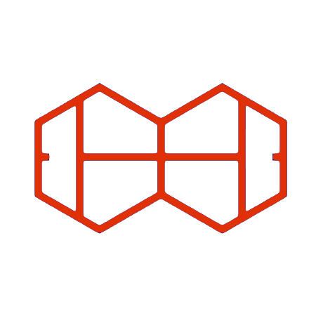

<p align="center">
  <a href="http://courthive.com/" target="blank"></a>
</p>

<p align="center">The server of the CourtHive competition management platform.</p>
<p align="center">
<a href="LICENSE"></a>
<a href="https://courthive.github.io/competition-factory-server/"></a>
</p>

## Description

The **Competition Factory Server** is the backend of the CourtHive platform, built on
[NestJS 11](https://nestjs.com/) and the [Competition Factory](https://github.com/CourtHive/competition-factory)
engine (`tods-competition-factory`). Every record it stores is a **CODES** record, CourtHive's canonical
competition data standard (a superset of the ITF's TODS), so the record the server writes is the same object
the [TMX](https://github.com/CourtHive/TMX) desk client and the
[public viewer](https://github.com/CourtHive/courthive-public) read.

The server and its clients run the same engine. A mutation is executed on the server first, under a
per-tournament lock, and is then applied by the client that sent it; other clients receive it as a broadcast.

### Key Features

- **Mutations over HTTP** — clients send an `executionQueue` of factory methods to `POST /factory`. The server
  authorizes the call, takes the tournament lock, runs the methods, saves the record and answers; the
  response is the client's acknowledgement
- **Realtime push over Socket.IO** — `/tmx` broadcasts mutations to everyone working on a tournament,
  `/public` delivers score and publish changes to the public viewer, `/hiveid` delivers person updates to
  signed-in participants
- **PostgreSQL storage** — JSONB records (lz4 compression is an operator option) behind a storage facade
  that keeps calendar, permission and participation indexes in step with each save; versioned migrations
  run at boot
- **Validated writes** — a wholesale record save is validated before anything is written, whatever its size;
  draw integrity is scanned and reported after mutations
- **Provider multi-tenancy** — organisations (providers) own their tournaments, users and configuration;
  provider-scoped roles (`PROVIDER_ADMIN`, `DIRECTOR`) are resolved per request
- **Identity from the identity provider** — sign-in, account and session routes moved to CourtHive's identity
  provider in v4.9.0; this server verifies tokens and enforces roles
- **Publishing and caching** — published tournament, event and schedule data is served from public routes
  that honour embargoes, with Redis caching; a Redis outage degrades to cache misses
- **Read-model projection** — public views are built off the request path from a transactional outbox
- **Score relay, rankings and ingest integration** — live scores, a rankings proxy and webhook, upstream
  tournament sync, and an audit log

## Documentation

Setup, architecture and API reference live in the documentation site:

**[courthive.github.io/competition-factory-server](https://courthive.github.io/competition-factory-server/)**

It covers getting started (prerequisites, installation, configuration), storage, authentication and roles,
the mutation flow and WebSocket gateway, read-model projection, public notifications, response caching, the
provider API, the provisioner, the score relay, the audit log and a Swagger UI. Operator notes are in
[`docs/`](docs/) — admin setup and recovery, storage configuration, provider theming and deployment.

## Quick Start

Requires Node.js >= 24, pnpm, PostgreSQL (configured through the `PG_*` variables in `.env`) and Redis.

```bash
pnpm install
pnpm admin:create -e admin@example.com -p yourpassword   # first super-admin
pnpm watch                                               # development server with reload
```

## Development

```bash
pnpm build          # NestJS compile to build/
pnpm start          # production server
pnpm lint           # ESLint, fails on any warning
pnpm check-types    # tsc --noEmit
pnpm test:unit      # Vitest, everything that does not need a live stack
pnpm test           # Vitest, the full suite including the *.e2e.spec.ts that need one
pnpm storybook      # the documentation site, locally
```

Branch from `dev` and open pull requests against `dev`; `main` advances at release checkpoints.

## Support

- Author - [Charles Allen](https://github.com/CourtHive)
- Website - [https://CourtHive.com](https://CourtHive.com/)

## License

The Competition Factory Server is [MIT licensed](LICENSE).
